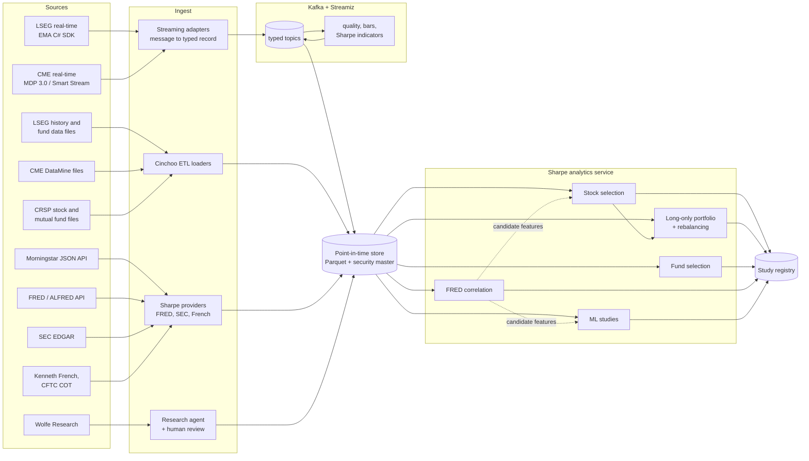

# Investment research platform

One shared data platform feeding five research workloads:

1. Stock selection
2. Long-only portfolio optimization with rebalancing
3. Mutual fund selection (long only)
4. Correlation studies against FRED economic series
5. Machine-learning studies for FX, forwards, OTC products and commodities, using CME data

This is a research platform, not a trading system. Its outputs are rankings, target portfolios, fund shortlists, correlation reports and study results, reviewed by people. Data comes from licensed LSEG (including Lipper fund data), CME, CRSP, Morningstar and Wolfe Research sources, plus public sources (FRED, SEC EDGAR, Kenneth French's Data Library, CFTC).

Status: design, 2026-11-10. Component facts were checked against the projects' repositories on that date.

---

## 1. The five workloads at a glance

| Workload | Question it answers | Main data | Sharpe phases used | Output |
|---|---|---|---|---|
| Stock selection | Which stocks rank best on price, fundamental, risk and research signals? | LSEG prices, CRSP stock history, SEC EDGAR fundamentals, Morningstar equity data, Wolfe Research views, Fama-French factors | 1, 2, 3, 5a | Ranked list with the reasons behind each pick |
| Long-only portfolio with rebalancing | How much of each selected stock, and when to rebalance? | Selection output, LSEG prices, CRSP history for backtests, research views | 3, 5a, 5c | Target weights, rebalance schedule, backtested results |
| Mutual fund selection | Which funds deserve a place, and in what mix? | CRSP Survivor-Bias-Free US Mutual Fund data, LSEG Lipper, Morningstar, SEC N-PORT and N-CSR, factors | 3, 5a, 5b | Fund shortlist, fund mix, overlap and style report |
| Correlation with FRED | How do assets and portfolios move with economic series, and with what lead or lag? | FRED and ALFRED, LSEG prices, CRSP indexes, CME settlements | 3, 8 (codependence), Charts | Correlation and lead-lag report |
| ML studies (FX, forwards, OTC, commodities) | Which features predict moves in these markets, and how reliably? | CME futures and options, LSEG FX spot and forward points, FRED, CFTC positioning | 6, 7, 8 | Study reports with validated results |

---

## 2. What changed from the first sketch

The first sketch was a single line: LSEG → Streamiz → Cinchoo ETL → Sharpe → research agent → selection.

| Change | Why |
|---|---|
| Data is parsed into typed records **before** it enters Kafka, not after Streamiz | Live LSEG and CME data arrive as structured messages, not text; typed records with registered schemas keep every consumer simple and catch bad data at the door |
| Cinchoo ETL handles **files** (CME DataMine files, LSEG history extracts, reference data, exports), not the live feed | That is what it is built for: CSV, fixed-width, XML, JSON, key-value, Avro and YAML |
| Streaming only where data is live (LSEG and CME real-time); everything else runs as **batch** jobs | FRED, SEC filings and fund data update daily to quarterly, and streaming them adds cost without benefit. Both paths land in the same point-in-time store |
| Sharpe runs **inside** the stream for indicators and bars, and as a separate **analytics service** for everything else | Low-latency features where needed; full analytics where they belong |
| The research agent produces **structured, verified, reviewed views** | Free text cannot be combined with numbers or audited later |
| Five workloads share one data layer, one security master and one study registry | Each study can be reproduced, and results from one feed the others (FRED correlations become candidate features; fund holdings link back to the stock data) |

---

## 3. Shared data platform



### 3.1 Sources

| Source | What it provides here | How it is read |
|---|---|---|
| LSEG real-time | Live equity, FX spot and FX forward-point quotes | LSEG Real-Time SDK, C# edition (EMA over ETA; open source, Apache-2.0, targets .NET 8 and runs in a .NET 10 host) |
| LSEG history and Lipper | Tick and bar history for backfills; Lipper fund data (classifications, peer groups, NAV and return history, fund metadata) | LSEG file deliveries and APIs; files loaded with Cinchoo ETL |
| CRSP | US stock history (daily and monthly returns including delisting returns, prices, shares outstanding, distributions, PERMNO and PERMCO identifiers), CRSP market indexes, and the Survivor-Bias-Free US Mutual Fund database (returns, NAV, net assets, expense ratios, holdings, dead and merged funds) | CRSP file deliveries loaded with Cinchoo ETL into the store; a Sharpe `CrspProvider` reads them back |
| Morningstar | Fund and equity data covered by your license, for example categories, star and analyst ratings, style box, fees, managers, holdings and returns | Morningstar's JSON API, through a typed Sharpe `MorningstarProvider` generated from your Morningstar JSON documentation; credentials supplied by each user |
| CME real-time | Futures and options quotes and trades | CME's real-time feeds covered by your license (MDP 3.0 multicast, which uses SBE encoding, or CME Smart Stream on Google Cloud); an adapter decodes messages into typed records |
| CME DataMine | Historical ticks, market depth, settlements, volume and open interest | Files loaded with Cinchoo ETL |
| FRED and ALFRED | Economic series, plus ALFRED's vintages (what each series looked like on a past date) | Sharpe FRED provider; each user supplies their own free FRED API key, as with EIA |
| SEC EDGAR | Company financials (XBRL), filings, fund holdings (N-PORT), fund costs and returns (N-CSR), fund census (N-CEN) | `Sharpe.Sec` |
| Wolfe Research | Equity and macro research | Your licensed delivery channel, read by the research agent (3.6) |
| Kenneth French's Data Library | Fama-French and momentum factor returns | Sharpe `FamaFrenchProvider` |
| CFTC Commitments of Traders | Weekly futures positioning by trader type | Public files loaded with Cinchoo ETL (suggested addition for the ML studies) |

### 3.2 Two ingestion paths

- **Streaming (live LSEG and CME):** an adapter per feed turns each message into a typed record (Protobuf, registered in Schema Registry) with the event timestamp, the receive timestamp and a sequence number. It publishes to Kafka keyed by instrument, so updates for one instrument stay in order. Status messages (stale, closed, halted) become records too, so nothing silently uses an old price.
- **Batch (everything else):** Cinchoo ETL loaders for files, Sharpe providers for APIs. Each loader validates rows against the same schemas and sends rejects, with the reason, to a dead-letter area.

Both paths write to the same point-in-time store.

### 3.3 Security master

Every workload needs to join data from different sources, so one security master maps every identifier:

- Equities: LSEG RIC, ticker, ISIN, CUSIP, SEC CIK, CRSP PERMNO and PERMCO, Morningstar security ID, sector, currency.
- Funds: SEC series and class IDs, ticker, CUSIP, Lipper fund ID, CRSP fund number, Morningstar fund and share-class IDs, share-class attributes.
- CME contracts: product code, contract month, expiry and roll dates, tick size and multiplier, underlying.
- FRED series: series ID, frequency, units, seasonal adjustment, release schedule.

It is loaded with Cinchoo ETL from your reference files and kept as a compacted Kafka topic and a table in the store, with effective dates, because tickers and RICs change over time.

### 3.4 Point-in-time store

- Parquet files on object storage, partitioned by dataset and date. A time-series database can be added later if interactive tick queries are needed.
- **Two timestamps on every record:** when the event happened, and when the platform could have known it. Studies always filter on the second. Examples: fundamentals become known on the SEC filing's acceptance date; a FRED value becomes known on its release date; a research view becomes known when the report arrived.
- **FRED vintages:** economic data is revised. ALFRED keeps each past vintage, so a study can use the GDP figure as first published rather than today's revised number.
- **Survivorship:** delisted stocks, merged or closed funds, and expired contracts stay in the store. CRSP is the base for history because it was built for this: stock returns include delisting returns, and the mutual fund database keeps dead and merged funds.
- **One source of record per field, cross-checked by the others:** when several vendors supply the same thing (fund returns from CRSP, Lipper and Morningstar; stock returns from CRSP and LSEG), the store marks one as the source of record and a daily job compares the rest. Differences beyond a tolerance go to a reconciliation report instead of being silently averaged.

### 3.5 Kafka and Streamiz (live data only)

Streamiz (the .NET port of Kafka Streams, 1.8.2 here) supports exactly-once processing, tumbling and hopping windows, RocksDB state stores, the Processor API and a topology test driver.

| Topic | Key | Content |
|---|---|---|
| `lseg.raw.v1`, `cme.raw.v1` | instrument | Untouched messages, short retention, for replaying parser fixes |
| `md.ticks.v1` | instrument | Typed trades and quotes from both feeds |
| `md.bars.1m.v1`, `md.bars.1d.v1` | instrument | OHLCV bars |
| `ref.securities.v1` | instrument | Security master (compacted) |
| `features.v1` | instrument | Sharpe indicator values per bar |
| `research.views.v1` | ticker | Approved research views |
| `dlq.*` | source key | Rejected records with the reason |

Topologies:

1. **Quality:** drop duplicates, flag stale, crossed or out-of-band prices, attach security-master fields.
2. **Bars:** tumbling windows by event time with a grace period for late messages; CME tick data can also produce information-driven bars (volume, dollar and imbalance bars, Sharpe phase 8).
3. **Indicators:** a processor keeps one set of Sharpe streaming indicators per instrument in a RocksDB-backed state store, so a restart resumes where it stopped.
4. **Tests:** every topology runs under the topology test driver with recorded data and must match Sharpe's batch results on the same data.

A sink copies all topics into the point-in-time store.

### 3.6 Research agent (Wolfe Research)

A code-controlled workflow, not an open-ended agent: it reads each report once, extracts structured views, and has no tools that can change anything.

1. **Collect** each report from your licensed delivery channel, store it as received with its arrival time and a content hash.
2. **Extract** with Claude (official Anthropic C# SDK, model `claude-opus-5-5`) into a fixed schema using structured outputs, one record per company or market covered:

```json
{
  "subject": "ticker, currency pair, commodity or macro topic",
  "kind": "equity | fx | rates | commodity | macro",
  "action": "initiate | upgrade | downgrade | reiterate | target_change | outlook | none",
  "rating": "string",
  "price_target": "number | null",
  "horizon_months": "number | null",
  "conviction": "low | medium | high",
  "thesis": "string (two sentences)",
  "catalysts": ["string"],
  "risks": ["string"],
  "evidence": [{ "quote": "string", "page": "number" }]
}
```

3. **Verify** in code that every quote appears on the stated page; unverified records are flagged for the reviewer.
4. **Review:** an analyst approves, edits or rejects each record. Only approved records reach `research.views.v1` and the store, with the reviewer and report hash attached.
5. **Track record:** views are scored later against outcomes, per analyst and per action type, so each workload can weight them by measured accuracy.

Notes: report text is treated as data, never as instructions; prompt caching covers the fixed instructions and schema; the Message Batches API (half price) re-processes archives overnight; the code checks for the `refusal` stop reason and enables server-side refusal fallbacks; a small hand-checked evaluation set is re-run whenever the prompt or model changes.

Equity views feed stock selection (4.1) and the portfolio's Black-Litterman views (4.2). FX, rates, commodity and macro views are stored as context for the correlation and ML studies, and can be tested as features there.

---

## 4. Workloads

### 4.1 Stock selection

1. **Universe:** listed equities passing liquidity, price and coverage filters, delisted names included. History and backtests use CRSP returns (with delisting returns); current data comes from LSEG.
2. **Signals,** all point-in-time:
   - Price: 12-month momentum skipping the last month, short-term reversal, trend and volatility from Sharpe indicators.
   - Fundamentals from SEC EDGAR: quality (profitability, accruals, Piotroski F-score), value (earnings and free-cash-flow yields), growth, balance-sheet risk.
   - Risk and factors: beta, idiosyncratic volatility, Fama-French exposures.
   - Research: approved Wolfe Research views (direction, price-target upside, conviction), decayed over time and weighted by track record.
   - Morningstar equity data your license covers (for example fair value estimates or moat ratings), tested as signals like any other.
   - Macro sensitivity: exposures to FRED series found useful in 4.4.
3. **Normalize:** cross-sectional ranks or winsorized z-scores, neutral by sector.
4. **Combine:** equal weights across signal families to start; weights based on measured predictive power (information coefficient) only after walk-forward tests, shrunk toward equal.
5. **Explain:** each selected stock carries its score by signal family and the research quotes behind it.
6. **Validate:** walk-forward tests of the ranking (top versus bottom groups, information coefficient by month), with the deflated Sharpe ratio when comparing variants.

### 4.2 Long-only portfolio optimization with rebalancing

- **Inputs:** the selected stocks (4.1), expected returns from Black-Litterman (market-implied prior plus approved research views, with confidence from conviction and track record), and a denoised covariance matrix.
- **Long-only constraints:** weights at least 0 and summing to 1; maximum weight per stock; sector limits; optional minimum position size and maximum number of holdings (integer constraints).
- **Optimizers** (Sharpe phase 5a): mean-variance, minimum CVaR, risk parity, HRP and HERC. Compare several on the same inputs.
- **Rebalancing policies,** compared in walk-forward backtests (phase 5c):
  - Calendar: monthly or quarterly.
  - Threshold: rebalance only when a weight drifts outside a band.
  - Hybrid: check on a calendar date, trade only outside the bands.
  - Each includes transaction costs and a turnover penalty in the objective, so the optimizer only trades when the expected gain beats the cost.
- **Report:** target weights, trades needed, turnover, expected risk and risk contributions, tracking error against a benchmark, and backtested results per policy.

### 4.3 Mutual fund selection (long only)

- **Data roles:**
  - CRSP Survivor-Bias-Free US Mutual Fund database: the base for all history (returns, net assets, fees, dead and merged funds), so persistence and alpha studies are not flattered by survivors only.
  - Lipper: classifications and peer groups, plus current data.
  - Morningstar: categories, star and analyst ratings, style box, manager data and fees.
  - SEC N-PORT and N-CSR: holdings, and costs and returns as filed.
  - Funds are linked across sources through the security master (CUSIP, tickers, SEC class IDs, CRSP fund number, Lipper and Morningstar IDs), and the reconciliation report flags return and fee differences.
- **Universe:** every fund in CRSP, current and dead, joined with Lipper and Morningstar. Keep one share class per fund for ranking (for example the cheapest class available to you).
- **Filters:** track record length, assets, expense ratio, Lipper classification or Morningstar category.
- **Performance and risk** (Sharpe phase 3): returns against the Lipper peer group, the Morningstar category and a benchmark; Sharpe, Sortino and information ratios; up- and down-market capture; maximum drawdown.
- **Vendor ratings as evidence, not answers:** Morningstar star and analyst ratings are shown in the report and tested as predictors of future fund performance, but the ranking does not simply copy them.
- **Skill versus factors:** Fama-French and momentum alpha with its t-statistic, rolling over time.
- **Style:** returns-based style analysis (a long-only regression of fund returns on style index returns, solved with Sharpe's optimizer) and holdings-based style from N-PORT.
- **Holdings:** active share against the benchmark, concentration, and overlap between candidate funds (from N-PORT positions).
- **Costs and persistence:** expense ratios from CRSP and the shareholder reports (N-CSR), and whether past rank predicts future rank, measured on the survivor-bias-free CRSP history.
- **Fund mix:** long-only optimization across the shortlisted funds (minimum variance or HRP, with limits per fund and a penalty for holdings overlap).
- **Report:** ranked shortlist with the evidence per fund, and the proposed mix with its combined holdings and factor exposures.

### 4.4 Correlation with FRED series

- **Align frequencies:** resample prices and returns to each series' frequency (for example month-end for monthly series) before comparing. CRSP market and size-decile indexes serve as long-history market proxies.
- **Make series comparable:** use changes rather than levels (log returns, percentage or first differences); fractional differentiation (phase 8) where some memory must be kept.
- **Use what was known at the time:** FRED release dates and ALFRED vintages, so a correlation does not rely on data revised later.
- **Measures:** Pearson, Spearman and Kendall correlation; distance correlation and mutual information for non-linear links (phase 8 codependence); rolling correlation to see stability; lead-lag cross-correlation to see which side moves first.
- **Significance:** confidence intervals from a block bootstrap (returns are autocorrelated), and false-discovery control when scanning many series at once.
- **Regimes:** split results by recession periods (FRED's recession indicator) and by rate regimes.
- **Many series at once:** denoise the correlation matrix and cluster series with dendrograms (phase 5a and Charts).
- **Report:** heatmaps, rolling charts, lead-lag tables, and a list of series worth testing as features in 4.1 and 4.5.

### 4.5 ML studies: FX, forwards, OTC products and commodities (CME data)

**Data construction**

- **Continuous futures:** roll rules (calendar, volume or open-interest based) and back-adjustment, built with phase 7 calendars and the phase 8 futures-roll tools, from CME DataMine history and live CME data.
- **Curves:** commodity forward curves from futures settlements, and FX forward curves from LSEG forward points (phase 6).
- **OTC products:** FX forwards and swaps priced from LSEG forward points with Sharpe phase 6. Implied yields from forwards give covered-interest-parity deviations against CME FX futures.
- **Bars:** time bars plus volume, dollar and imbalance bars from CME tick data (phase 8).

**Features**

- Carry and roll yield; curve slope and curvature; futures-versus-spot basis; covered-interest-parity deviations.
- Options-implied volatility, skew and term structure from CME options (phase 6 volatility surfaces).
- Volume, open interest and CFTC positioning.
- Macro series and surprises from FRED (with vintages), and the candidates found in 4.4.
- Fractionally differentiated prices, structural-break tests, entropy and microstructure measures (phase 8).
- Wolfe Research FX, rates, commodity and macro views, tested like any other feature.

**Labels, models and validation**

- Labels: triple-barrier and trend-scanning labels; meta-labeling on top of simple base rules.
- Models: ML.NET learners (for example gradient-boosted trees), with sample weights for overlapping labels (phase 8).
- Validation: purged and combinatorial purged cross-validation, anchored and rolling walk-forward, clustered feature importance, and the deflated Sharpe ratio and probability of backtest overfitting for any rule a study proposes.
- Every study is recorded in the study registry (section 5), so it can be re-run and compared.

---

## 5. Reproducibility: the study registry

Every run of every workload records:

- Dataset versions (with point-in-time cut-off dates), the security-master version and FRED vintages used.
- Code version, parameters, model and prompt versions.
- Validation results and the final report.

The same code processes live data and history: studies replay archived topics or files through the same Streamiz topologies and Sharpe code, so a study's features are exactly what the live platform would have produced.

---

## 6. Operations and governance

- **Monitoring:** Streamiz Prometheus or OpenTelemetry metrics, consumer lag, data freshness per feed during market hours, dead-letter counts, LLM cost and refusal rates.
- **Entitlements:** access to LSEG, CME and Wolfe Research data in the store follows your licenses per user and per dataset; derived outputs are tagged with the datasets they came from.
- **Security:** LSEG, CME, FRED and Claude credentials in a secret store; research and outputs stored with access control; an audit log of who approved each research view and each report.
- **Model risk:** versioned models, prompts and evaluation sets; every published result points to its registry entry.

---

## 7. Build order

| Stage | Platform work | Workload unlocked | Needs from Sharpe |
|---|---|---|---|
| 0 | Security master, point-in-time store, Cinchoo ETL loaders, FRED, SEC and CRSP providers, vendor reconciliation report | — | Phase 0, 2 |
| 1 | FRED correlation studies on daily and monthly data | 4.4 Correlation | Phase 3 metrics; the FRED provider is needed early, so it moves forward from 5b |
| 2 | LSEG adapter, Kafka and Streamiz bars and indicators | — | Phase 1 (v0.1) |
| 3 | Research agent with review queue | — | none (Claude API) |
| 4 | Stock selection | 4.1 | Phases 1–3 |
| 5 | Long-only portfolio and rebalancing | 4.2 | Phase 5a (v0.5), 5c (v1.0) |
| 6 | Fund data (CRSP mutual funds, Lipper, Morningstar provider, N-PORT, N-CSR) and fund selection | 4.3 | Phase 5b (v0.6) |
| 7 | CME adapter and DataMine loaders; FX and commodity curves | — | Phase 6 (v1.1), 7 (v1.2) |
| 8 | ML studies | 4.5 | Phase 8 (v1.3) |

---

## 8. Open decisions

| Decision | Options | Recommendation |
|---|---|---|
| CME real-time feed | MDP 3.0 multicast, or CME Smart Stream on Google Cloud | Whichever your CME license and network setup support; the adapter hides the difference |
| LSEG connection | LSEG Real-Time Optimized (cloud) or an on-site Real-Time Distribution System | Whichever your LSEG setup provides |
| Wire format | Protobuf or Avro | Protobuf: compact, typed C# classes, supported by Streamiz SerDes |
| Store | Parquet only, or Parquet plus a time-series database | Parquet first |
| Study registry | A simple table in the store, or a dedicated experiment tracker | Start with a table; move to a tracker if studies multiply |
| Fund share class | Cheapest class, institutional class, or all classes | One class per fund for ranking, all classes kept for reference |
| Source of record per field | For example, fund returns from CRSP, Lipper or Morningstar | CRSP for history; Lipper and Morningstar for current data, classifications and ratings; the others cross-check |
| Morningstar client | Hand-written, or generated from your Morningstar JSON documentation | Generated: a `tools/morningstar-codegen` step reads the JSON documentation and produces typed C# requests and records, as `eia-codegen` does for EIA |
