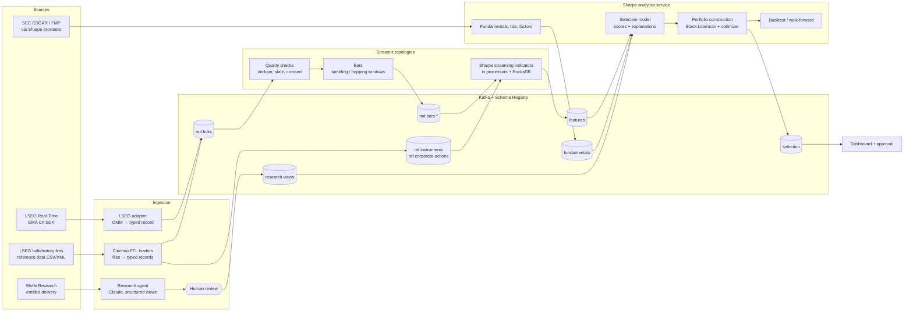

# Market-data-to-stock-selection pipeline

LSEG live prices → Streamiz → Sharpe, plus a research agent that reads Wolfe Research, combined into a stock selection.

This document reviews the pipeline as first sketched, then gives an improved design. The improved design keeps all five parts (LSEG, Streamiz, Cinchoo ETL, Sharpe, the research agent), but changes where each one sits and adds the parts that a production selection process needs: schemas, replay, validation, human review and governance.

Status: design, 2026-11-10. Component facts were checked against the projects' repositories on that date.

---

## 1. The pipeline as first sketched

1. Take live prices from LSEG.
2. Feed them into Streamiz.
3. Parse the data with Cinchoo ETL.
4. Feed it into Sharpe.
5. Use an agent that gets research from Wolfe Research.
6. Combine everything to produce a stock selection.

### What to change, and why

| # | Issue | Why it matters | Fix |
|---|---|---|---|
| 1 | Parsing happens **after** the data is already in Kafka/Streamiz | Untyped messages in Kafka mean every consumer re-parses them, a bad record fails mid-stream, and a field change upstream silently breaks consumers | Parse at the edge: the LSEG adapter turns each update into a typed record with a registered schema **before** it reaches Kafka |
| 2 | Cinchoo ETL is used on the live feed | Cinchoo ETL reads and writes files and text formats (CSV, fixed-width, XML, JSON, key-value, Avro, YAML). Live LSEG data arrives through the Real-Time SDK as structured OMM field lists, so there is no text to parse | Use Cinchoo ETL where it fits: bulk and historical files (backfills, reference data, research metadata) and exports. Live data goes SDK → typed record → Kafka |
| 3 | Sharpe sits at the end, after streaming | Indicators computed downstream add latency and a second copy of state | Run Sharpe's **streaming** indicators inside Streamiz processors. Run Sharpe's batch analytics (fundamentals, risk, optimization, backtests) in a separate service that reads the topics |
| 4 | The research agent is a side branch | Free-text research cannot be combined with numbers, and nobody can check later what the agent claimed or when | The agent emits **structured, timestamped views with quotes from the source**, reviewed by a person, published to a topic. Views enter the selection as a signal and as Black-Litterman views |
| 5 | No replay, validation or point-in-time data | A selection model cannot be trusted without walk-forward tests, and backtests leak the future if data is not time-stamped by when it became known | Keep raw topics replayable, archive everything, run the same topology on history, validate with walk-forward and purged cross-validation |
| 6 | No human checkpoint, governance or monitoring | LLM output, licensed data and investment decisions all carry risk | Human approval before anything is acted on, license checks for LSEG and Wolfe Research, metrics, alerts and an audit trail |

---

## 2. Improved design



### 2.1 LSEG ingestion (live)

- **SDK:** the LSEG Real-Time SDK, C# edition (Enterprise Message API, EMA, on top of the Enterprise Transport API). It is open source under Apache-2.0 and targets .NET 8 (it runs fine in a .NET 10 host). It connects to LSEG Real-Time Optimized in the cloud or to an on-site Real-Time Distribution System.
- **Requests:** subscribe per RIC with a *view* (only the fields you need, for example last trade, bid, ask, sizes, cumulative volume, trade time) to cut bandwidth. Use streaming requests for the live universe and snapshots for one-off lookups.
- **Adapter responsibilities:**
  - Map each OMM update to a typed `Tick` record (trade or quote) with the exchange timestamp, the receive timestamp and a sequence number.
  - Produce to `md.ticks.v1` keyed by RIC, so every update for one instrument stays in order on one partition.
  - Write the untouched message to `lseg.raw.v1` (short retention) so parsing bugs can be replayed and fixed.
  - Handle the SDK's status messages: a stale or closed item emits a status record, so downstream code knows the price is no longer live instead of silently using the last one.
- **Credentials:** LSEG machine IDs or service-account credentials live in a secret store, never in configuration files.

### 2.2 Cinchoo ETL (files and batch)

Cinchoo ETL (MIT) reads and writes CSV, fixed-width, XML, JSON, key-value, Avro and YAML. In this pipeline it handles everything that arrives as a file:

- **Historical backfill:** bulk tick and bar extracts from LSEG (for example Tick History CSV files) are read with Cinchoo ETL into the same typed `Tick` / `Bar` records and produced to the same topics, so history and live data share one schema and one topology.
- **Reference data:** instrument master (RIC ↔ ticker ↔ ISIN ↔ CIK, sector, currency, lot size), exchange holidays and corporate actions, loaded into compacted topics (`ref.instruments.v1`, `ref.corporate-actions.v1`).
- **Research metadata:** spreadsheets of coverage lists or rating histories, if Wolfe Research or your team provides them.
- **Exports:** the selection and its explanations to CSV, Excel-friendly CSV or JSON for people and other systems.

Every loader validates rows against the schema and sends bad rows to a dead-letter topic with the reason, instead of stopping.

### 2.3 Kafka and schemas

- **Schema Registry with Protobuf or Avro** for every topic. Streamiz already ships Schema Registry SerDes for Avro, Protobuf and JSON.
- **Topic plan** (versioned names so a breaking change gets a new topic):

| Topic | Key | Content | Retention |
|---|---|---|---|
| `lseg.raw.v1` | RIC | Untouched SDK messages | 7 days |
| `md.ticks.v1` | RIC | Typed trades and quotes | 30 days, plus archive |
| `md.bars.1m.v1`, `md.bars.1d.v1` | RIC | OHLCV bars | Long, plus archive |
| `ref.instruments.v1` | RIC | Instrument master | Compacted |
| `ref.corporate-actions.v1` | RIC | Splits, dividends, symbol changes | Compacted |
| `features.v1` | RIC | Indicator values per bar | Long |
| `fundamentals.v1` | CIK | Point-in-time statement data | Compacted by period |
| `research.views.v1` | ticker | Reviewed analyst views | Forever |
| `selection.v1` | run id | Ranked list, scores, target weights | Forever |
| `dlq.*` | source key | Rejected records with the reason | 30 days |

- **Archive:** a sink copies ticks, bars, features and views to object storage (Parquet) or a time-series database for research and backtests.

### 2.4 Streamiz topologies

Streamiz (the .NET port of Kafka Streams, 1.8.2 here) supports exactly-once processing, tumbling and hopping windows, RocksDB state stores, the Processor API and a topology test driver.

1. **Quality:** drop duplicates by sequence number; flag stale, crossed (bid above ask) or out-of-band prices; join with `ref.instruments` as a KTable to attach currency, sector and lot size.
2. **Bars:** tumbling windows (1 minute, 1 day) build OHLCV bars; hopping windows give rolling statistics. Use event time (the exchange timestamp) with a grace period for late ticks.
3. **Corporate actions:** join with `ref.corporate-actions` to emit both raw and adjusted bars.
4. **Indicators with Sharpe:** a processor holds one Sharpe streaming indicator set per RIC in a RocksDB-backed state store and calls `Add(bar)` on each new bar (the phase 1 streaming API). Results go to `features.v1`. Because the state is in a store, a restart resumes exactly where it stopped.
5. **Exactly-once** processing guarantee on, so a crash never double-counts a bar.
6. **Tests:** every topology runs under the Streamiz topology test driver with recorded ticks, and must produce the same bars and indicators as Sharpe's batch API on the same data.

### 2.5 Sharpe analytics service

A separate .NET service consumes the topics and uses Sharpe's batch APIs:

- **Fundamentals** from SEC EDGAR (free) and FMP, published point-in-time: a value becomes visible on the filing's acceptance date, not the period end.
- **Risk and factors:** volatility, drawdown, beta, Fama-French exposures, denoised covariance.
- **Selection model** (section 2.7).
- **Portfolio construction** with the phase 5a optimizers.
- **Backtests and walk-forward validation** with the phase 5c engine, reading the archived topics.

### 2.6 Research agent (Wolfe Research)

**Access and terms first.** Wolfe Research is a subscription research provider. The agent may only read research you are entitled to, through a delivery channel Wolfe Research provides or approves (for example, reports delivered to you by email or downloaded from their portal under your login). Before building, confirm with your Wolfe Research account team that automated ingestion and processing by an AI model are permitted under your agreement, and that outputs stay internal. Do not scrape the site.

**What the agent does**

1. **Collect:** watch the approved delivery channel, store each report as received (PDF plus metadata) with a received timestamp and a content hash. The received timestamp is the point-in-time date for backtests.
2. **Extract:** send the report to Claude (the official Anthropic C# SDK, model `claude-opus-5-5`) with a fixed schema using structured outputs. One record per company mentioned:

```json
{
  "ticker": "string",
  "action": "initiate | upgrade | downgrade | reiterate | target_change | none",
  "rating": "string",
  "price_target": "number | null",
  "horizon_months": "number | null",
  "conviction": "low | medium | high",
  "thesis": "string (two sentences)",
  "catalysts": ["string"],
  "risks": ["string"],
  "evidence": [{ "quote": "string", "page": "number" }]
}
```

3. **Verify:** code (not the model) checks that every `evidence.quote` really appears on the stated page of the report. A record that fails goes to review marked as unverified.
4. **Review:** an analyst approves, edits or rejects each record in a review queue. Only approved records are published to `research.views.v1`, with the reviewer and the report hash attached.
5. **Track record:** each view is scored later against what the stock did, per analyst and per action type. The selection uses that hit rate to decide how much a view counts.

**Design notes**

- This is a workflow, not an open-ended agent: one structured extraction call per report, with the loop controlled by code. It has no tools that can trade, send messages or change data.
- Report text is untrusted input. Instructions found inside a report are never followed; the model only fills the schema, and the schema is validated before use.
- Use prompt caching for the fixed instructions and schema, and the Message Batches API (half price) for re-processing archives overnight.
- With `claude-opus-5-5`, check the `refusal` stop reason, and turn on server-side refusal fallbacks (`fallbacks: "default"` with the server-side fallback beta) so a declined request is retried on a fallback model within the same call.
- Keep a small evaluation set of reports with hand-checked extractions, and re-run it whenever the prompt or model changes.

### 2.7 Combining everything into a stock selection

1. **Universe:** listed equities that pass liquidity (average daily traded value), price and data-coverage filters, with history including delisted names to avoid survivorship bias.
2. **Signals,** each computed point-in-time:
   - Price: momentum (12-month return skipping the last month), short-term reversal, trend and volatility from Sharpe indicators.
   - Fundamentals: quality (profitability, accruals, Piotroski F-score), value (earnings and free-cash-flow yields), growth, balance-sheet risk.
   - Risk and factors: beta, idiosyncratic volatility, Fama-French exposures.
   - Research: approved Wolfe Research views (direction, price-target upside, conviction), decayed over time and weighted by the measured track record.
   - Later, machine learning (Sharpe phase 8): meta-labeling to decide which signals to act on, and bet sizing.
3. **Normalize:** cross-sectional ranks or winsorized z-scores, neutralized by sector so the model does not just pick one industry.
4. **Combine:** start with equal weights across signal families. Move to weights based on each signal's measured predictive power (information coefficient) only after walk-forward tests, with shrinkage toward equal weights.
5. **Explain:** every selected stock carries its score broken down by signal family, plus the research views and quotes behind it.
6. **Portfolio:** turn scores into weights with Black-Litterman, where approved research views become the views and their confidence comes from conviction and track record. Then optimize with Sharpe's phase 5a optimizers under constraints (sector and position limits, turnover, liquidity).
7. **Validate before use:** anchored and rolling walk-forward backtests (phase 5c), combinatorial purged cross-validation, the deflated Sharpe ratio and the probability of backtest overfitting (phase 8). A model change ships only if it beats the current one out of sample.
8. **Act with a person in the loop:** the selection and target weights go to a dashboard for approval. Start with paper trading; any connection to order execution is a later, separate decision.

---

## 3. One code path for live and history

- The same Streamiz topology processes live ticks and replayed history. Backtests replay archived topics (or backfill files loaded with Cinchoo ETL) through it, so the features in a backtest are exactly the features the live system would have produced.
- Every record carries two timestamps: when the event happened and when the system learned about it. Backtests use the second, which prevents look-ahead bias for fundamentals and research.

---

## 4. Operations and governance

- **Monitoring:** Streamiz's Prometheus or OpenTelemetry metrics, consumer lag, data freshness per RIC, dead-letter counts, LLM cost and refusal rates. Alert when the feed goes stale during market hours.
- **Licensing:**
  - LSEG data terms cover how real-time data may be used (for example, automated "non-display" use by programs), stored and turned into derived data. Confirm your LSEG agreement covers this pipeline.
  - Wolfe Research terms cover internal use, redistribution and AI processing (section 2.6).
  - Open-source parts: LSEG Real-Time SDK (Apache-2.0), Streamiz (MIT), Cinchoo ETL (MIT), Sharpe (MIT).
- **Security:** credentials in a secret store; research and selections are confidential and stored with access control; an audit log records who approved each view and each selection.
- **Model risk:** version every selection model and prompt, keep the evaluation sets, and record which versions produced each run.

---

## 5. Build order

| Stage | Pipeline work | Needs from Sharpe |
|---|---|---|
| 0 | Kafka and Schema Registry; LSEG adapter for about 20 RICs into `md.ticks` and `lseg.raw`; archive sink | none |
| 1 | Streamiz quality checks and bars; Cinchoo ETL backfill and reference-data loaders | none |
| 2 | Indicator processor in Streamiz | Phase 1 streaming indicators (v0.1) |
| 3 | Point-in-time fundamentals and risk | Phase 2 (v0.2), phase 3 (v0.3) |
| 4 | Research agent with review queue and track-record scoring | none (Claude API) |
| 5 | Selection model, Black-Litterman with research views, optimizer | Phase 5a (v0.5) |
| 6 | Walk-forward backtests, dashboard, paper trading | Phase 5c (v1.0) |
| 7 | Meta-labeling and bet sizing | Phase 8 (v1.3) |

---

## 6. Open decisions

| Decision | Options | Recommendation |
|---|---|---|
| LSEG connection | LSEG Real-Time Optimized (cloud) or an on-site Real-Time Distribution System | Whichever your LSEG contract provides; the adapter hides the difference |
| Wire format | Protobuf or Avro | Protobuf: compact, typed C# classes, supported by Streamiz SerDes |
| Tick archive | Parquet on object storage, or a time-series database | Parquet for research and backtests; add a time-series database only if interactive tick queries are needed |
| Research delivery | Email, portal download, or a vendor feed | The channel Wolfe Research approves for automated use |
| Execution | None, paper trading, or a broker connection | Paper trading until walk-forward results and the approval process are proven |
